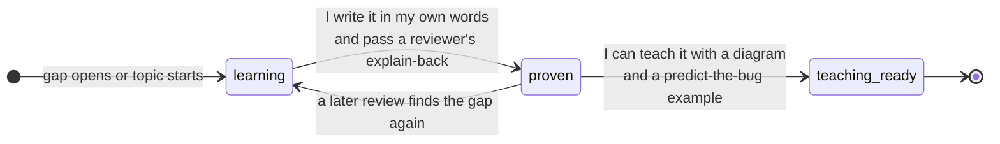

# Knowledge base

Notes on what I've learned, written in my own words. A note counts as knowledge only after a reviewer agent has checked it.

## How a note moves

| Status | Meaning | Who changes it |
|---|---|---|
| `learning` | The note exists but isn't written up or checked yet | anyone |
| `proven` | Written in my own words, and I passed a reviewer's explain-back check | **reviewer agent only** |
| `teaching-ready` | I could teach it, with a diagram and a predict-the-bug example | reviewer agent |

## Rules
1. **I write the "In my own words" section myself.** Agents can ask questions, give hints, draw diagrams and write practice cards, but they never fill that section in for me.
2. **A gap closing means a note.** When a line moves to *Gaps closing* in `records/gap_analysis.md`, the coach makes or updates the matching note and links it in `gaps:`.
3. **Evidence is dated.** Every status change adds a line under *Evidence* with the date and session.
4. **Scrub first.** No company names, IP or block names, people, server or depot paths. The pre-commit hook enforces this.
5. **Every note feeds practice.** Each note lists its card ids in `cards:`, and those cards appear on the daily practice page.

## Layout
| Folder | What goes there |
|---|---|
| `concepts/` | SystemVerilog, UVM and DPI-C ideas: how and why they work |
| `tools/` | Simulators, coverage tools, Perforce, LSF/cron, regression flow |
| `debug-playbooks/` | Symptom → hypotheses → checks → root cause → DUT or TB |
| `glossary.md` | One-line definitions, in my own words |
| `interview-prep.md` | Question bank to answer out loud |
| `cards/` | Practice cards (JSON) used by the daily practice page |
| `interactive/` | Interactive diagrams (HTML), opened from notes and from the site |

Copy `_template.md` to start a new note.
