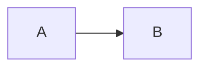

## In my own words
> Write this yourself, without AI. Aim for 3–6 sentences: what it is, why it exists, and how it fails.

## Diagram


## Explain-back check
- Question the reviewer will ask before marking this note `proven`

## Predict the bug
```systemverilog
// a short snippet with the classic mistake
```

## Evidence
- YYYY-MM-DD — what happened (session, review, real work)

## Links
- Related notes
