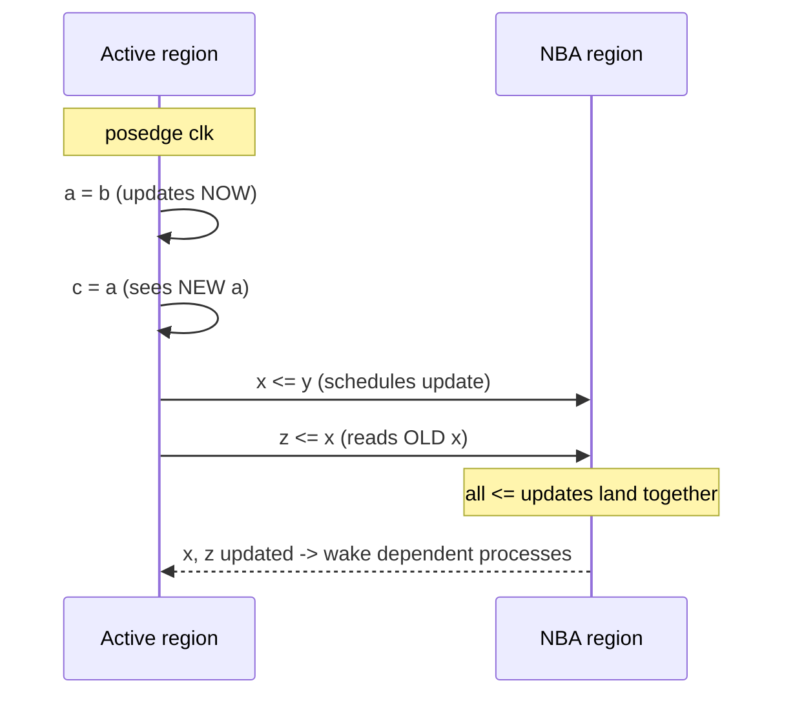

## In my own words
> _Not written yet. Write this yourself, without AI: what it is, why it exists, how it fails. A reviewer checks it before this note becomes `proven`._

## Diagram


▶ **Interactive:** [sv scheduling](../interactive/sv-scheduling.html)

## Explain-back check
- Two flops swap values: write it with `=` and with `<=`. Which one swaps, and why?
- Why must class fields in a UVM component never be assigned with `<=`?
- Which simulation region applies non-blocking updates?

## Predict the bug
What's wrong, and what would you see in simulation?
```systemverilog
always_ff @(posedge clk) begin
  q1 = d;
  q2 = q1;   // meant to be a 2-stage shift register
end
```

## Evidence
- _none yet_

## Links
- [[sv-evaluation-timing]]
