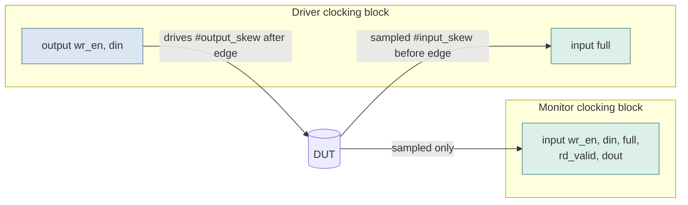

## In my own words
> _Not written yet. Write this yourself, without AI: what it is, why it exists, how it fails. A reviewer checks it before this note becomes `proven`._

## Diagram


▶ **Interactive:** [clocking skew](../interactive/clocking-skew.html)

## Explain-back check
- Is direction in a clocking block decided by the DUT's ports or by the component using it? Give the monitor as an example.
- With `default input #1step output #2;`, when is an input sampled and when is an output driven?
- Why does the monitor's clocking block contain only inputs?

## Predict the bug
What's wrong, and what would you see in simulation?
```systemverilog
clocking mon_cb @(posedge clk);
  output wr_en, din;   // monitor clocking block
  input  full, dout;
endclocking
```

## Evidence
- 2026-10 (FIFO project) — decided: monitor clocking block is all `input`

## Links
- [[sv-evaluation-timing]]
