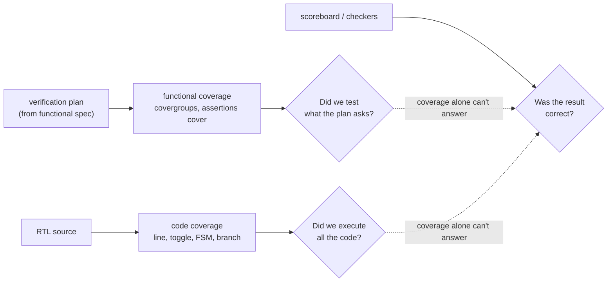

## In my own words
> _Not written yet. Write this yourself, without AI: what it is, why it exists, how it fails. A reviewer checks it before this note becomes `proven`._

## Diagram

## Explain-back check
- Who chooses the covergroups, and from which document?
- Why does 100% coverage with a disabled scoreboard prove nothing?
- Which kind shows the plan is complete, and which can hit 100% while a feature is missing?

## Evidence
- 2026-10-28 — confirmed: coverage records, it does not check

## Links
- [[coverage-group-vs-instance]]
- [[stress-vs-smoke]]
