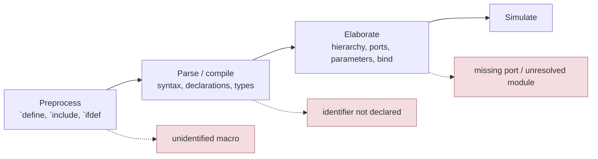

## In my own words
> _Not written yet. Write this yourself, without AI: what it is, why it exists, how it fails. A reviewer checks it before this note becomes `proven`._

## Diagram

## Explain-back check
- Put each error in its stage: unidentified macro, undeclared identifier, missing input port.
- Method (not instance): how do you find which filelist/include should pull in a missing file?

## Evidence
- 2026-10-06 — Q17/Q18: good triage, stages not distinguished

## Links
- [[compile-errors]]
