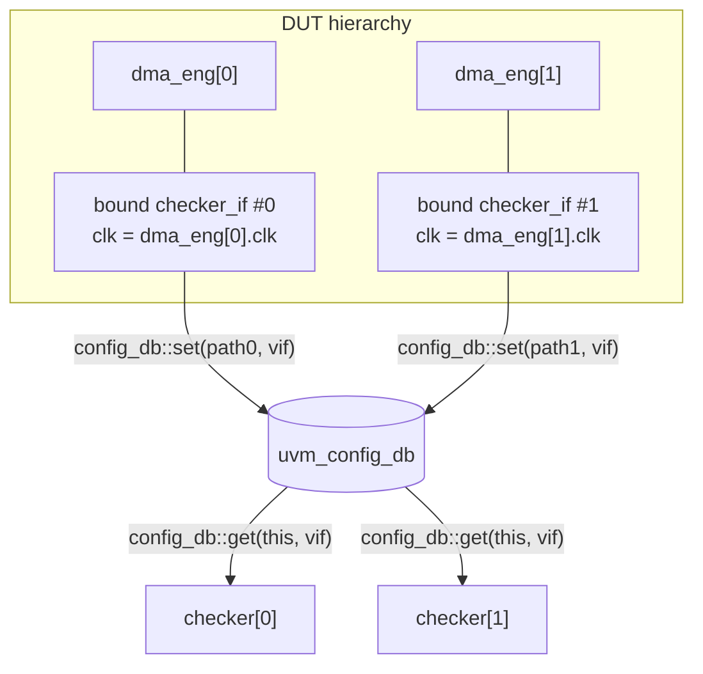

## In my own words
> _Not written yet. Write this yourself, without AI: what it is, why it exists, how it fails. A reviewer checks it before this note becomes `proven`._

## Diagram

## Explain-back check
- In a `bind`, whose scope are the port names resolved in, and why does that give each copy its own clock?
- Who calls `config_db::set` and who calls `get` for a bound interface? What happens if the paths don't match?
- Trigger vs root cause for the multi-instance checker failure: say each in one sentence.

## Evidence
- 2026-10-28 — confirmed: bind sets vif into config_db, component gets it; single-instance binding was the root

## Links
- [[uvm-hdl-read]]
- [[dut-vs-tb-verdict]]
