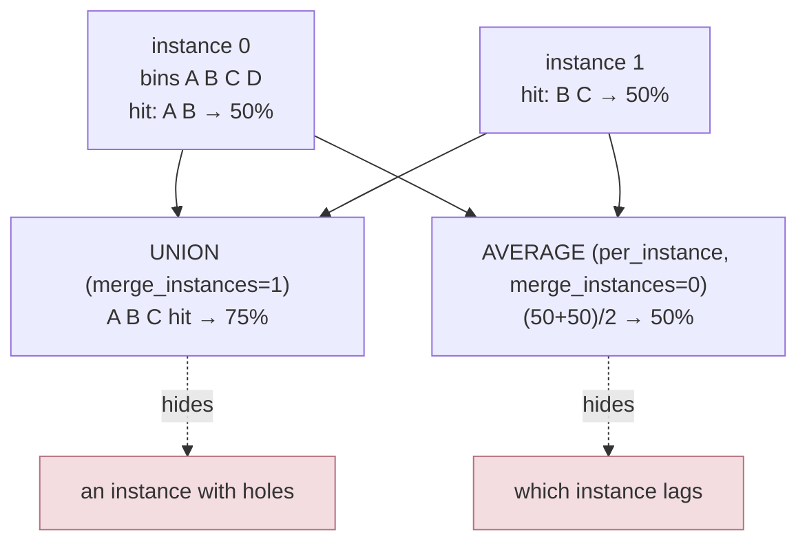

## In my own words
> _Not written yet. Write this yourself, without AI: what it is, why it exists, how it fails. A reviewer checks it before this note becomes `proven`._

## Diagram

▶ **Interactive:** [coverage calculator](../interactive/coverage-calculator.html)

## Explain-back check
- Compute union and average for 4 bins, 2 instances: inst0 hits A,B; inst1 hits B,C.
- At sign-off, what can a 100% union-mode group score hide?
- Which mode does your team's flow use, and how did you check?

## Evidence
- 2026-10-06 — Q11 not confirmed (roles reversed)
- 2026-10-28 — calculated 75% / 50% with one hint; flow mode = average (Verdi)

## Links
- [[code-vs-functional-coverage]]
