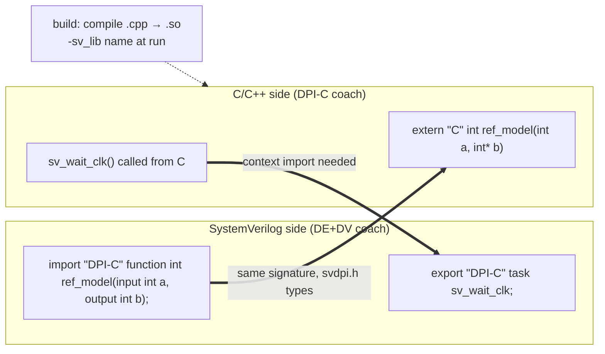

## In my own words
> _Not written yet. Write this yourself, without AI: what it is, why it exists, how it fails. A reviewer checks it before this note becomes `proven`._

## Diagram

## Explain-back check
- Name the type mapping for `int`, `bit [31:0]`, `string` and an open array across DPI-C.
- When does an import have to be `context` instead of `pure`?
- Who allocates and who frees memory passed across the boundary?

## Evidence
- 2026-10-06 — Q25: not yet understood (joint gap)

## Links
- [[frontdoor-vs-backdoor]]
