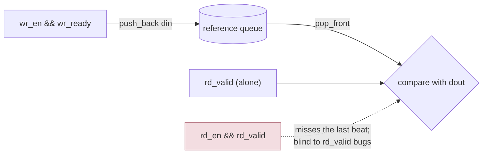

## In my own words
> _Not written yet. Write this yourself, without AI: what it is, why it exists, how it fails. A reviewer checks it before this note becomes `proven`._

## Diagram

▶ **Interactive:** [fifo scoreboard](../interactive/fifo-scoreboard.html)

## Explain-back check
- With 1-cycle read latency, on which cycle is `rd_en && rd_valid` true for a single read?
- Why does gating the pop on `rd_en` hide a DUT that raises `rd_valid` spuriously?

## Evidence
- 2026-10 (FIFO project) — scoreboard architecture decided: push on wr_en && wr_ready, pop on rd_valid

## Links
- [[dut-vs-tb-verdict]]
