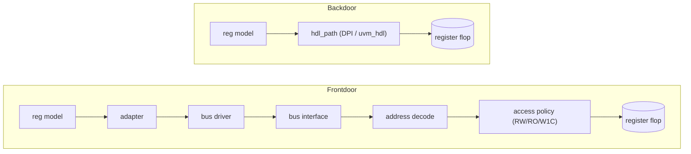

## In my own words
> _Not written yet. Write this yourself, without AI: what it is, why it exists, how it fails. A reviewer checks it before this note becomes `proven`._

## Diagram

▶ **Interactive:** [ral frontdoor](../interactive/ral-frontdoor.html)

## Explain-back check
- Name three things a frontdoor access exercises that a backdoor skips.
- Give two good reasons to use backdoor anyway.
- Where does DPI-C sit in a backdoor access?

## Evidence
- 2026-10-06 — Q24 definition confirmed, 'why' missing
- 2026-10-28 — confirmed: direct DUT access, internal signals, speed

## Links
- [[ral-frontdoor-path]]
- [[dpi-c-boundary]]
