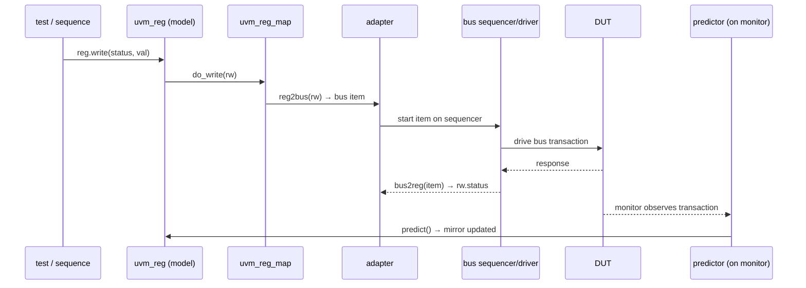

## In my own words
> _Not written yet. Write this yourself, without AI: what it is, why it exists, how it fails. A reviewer checks it before this note becomes `proven`._

## Diagram

▶ **Interactive:** [ral frontdoor](../interactive/ral-frontdoor.html)

## Explain-back check
- Name each hop of a frontdoor write, and which class owns it.
- What do reg2bus and bus2reg convert between?
- Explicit vs auto prediction: who updates the mirror in each?

## Evidence
- 2026-10 — frontdoor work done at the job; mechanism not yet explained back
- 2026-10-29 — 3-day sandbox project started

## Links
- [[frontdoor-vs-backdoor]]
