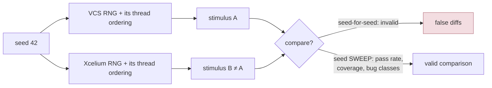

## In my own words
> _Not written yet. Write this yourself, without AI: what it is, why it exists, how it fails. A reviewer checks it before this note becomes `proven`._

## Diagram

## Explain-back check
- Why can the same seed give different stimulus on two simulators?
- What should the migration comparison measure instead?

## Evidence
- 2026-10-06 — Q28 misconception with project impact

## Links
- [[vcs-vs-xcelium]]
