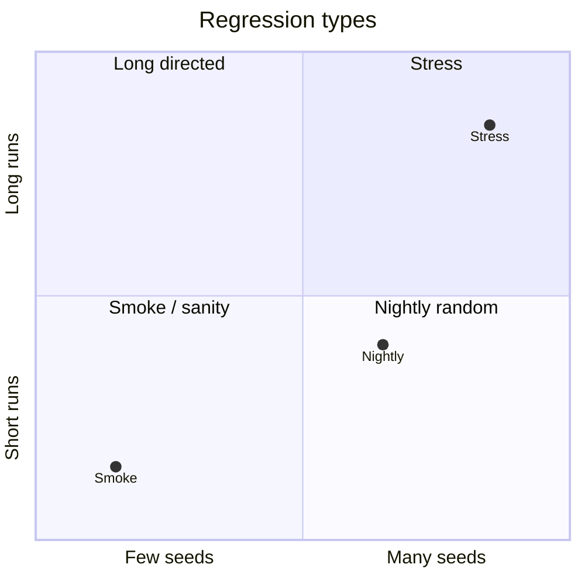

## In my own words
> _Not written yet. Write this yourself, without AI: what it is, why it exists, how it fails. A reviewer checks it before this note becomes `proven`._

## Diagram

## Explain-back check
- What is a smoke regression for, and what is a stress regression for?
- Why is the smallest test the first one you bring up?

## Evidence
- 2026-10-06 — Q16 incorrect, Q19 half

## Links
- [[regression-flow]]
