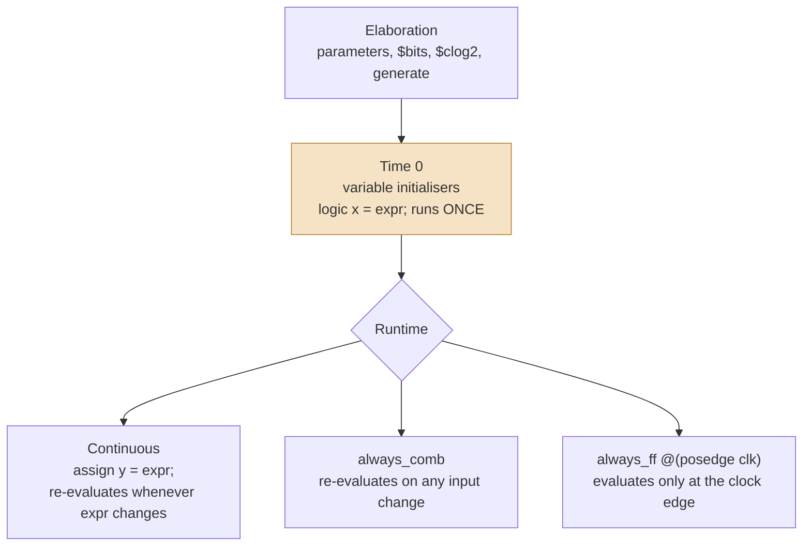

## In my own words
> _Not written yet. Write this yourself, without AI: what it is, why it exists, how it fails. A reviewer checks it before this note becomes `proven`._

## Diagram


▶ **Interactive:** [sv scheduling](../interactive/sv-scheduling.html)

## Explain-back check
- Why does `logic do_write = wr_en && !full;` freeze, while `assign do_write = wr_en && !full;` doesn't?
- What does `$bits(DEPTH)` return when `DEPTH` is an `int` parameter, and what did you actually want?
- List the four 'moments' an expression can be evaluated, with one construct for each.

## Predict the bug
What's wrong, and what would you see in simulation?
```systemverilog
logic [3:0] count;
logic do_write = wr_en && !full;   // intended: follows wr_en every cycle
always_ff @(posedge clk) if (do_write) count <= count + 1;
```

## Evidence
- 2026-10 (FIFO project) — two bugs traced to this root: time-zero initialiser and `$bits` on an int parameter

## Links
- [[blocking-vs-nonblocking]]
- [[clocking-block-direction]]
