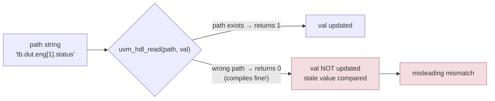

## In my own words
> _Not written yet. Write this yourself, without AI: what it is, why it exists, how it fails. A reviewer checks it before this note becomes `proven`._

## Diagram


## Explain-back check
- Why does a typo in a uvm_hdl_read path compile cleanly?
- What should the caller do with the return value?

## Predict the bug
What's wrong, and what would you see in simulation?
```systemverilog
bit [31:0] v;
uvm_hdl_read($sformatf("tb.dut.eng[%0d].stat", i), v);
if (v != exp) `uvm_error("CHK", "mismatch")
```

## Evidence
- 2026-10-28 — confirmed after second explain-back

## Links
- [[config-db-and-bind]]
- [[frontdoor-vs-backdoor]]
