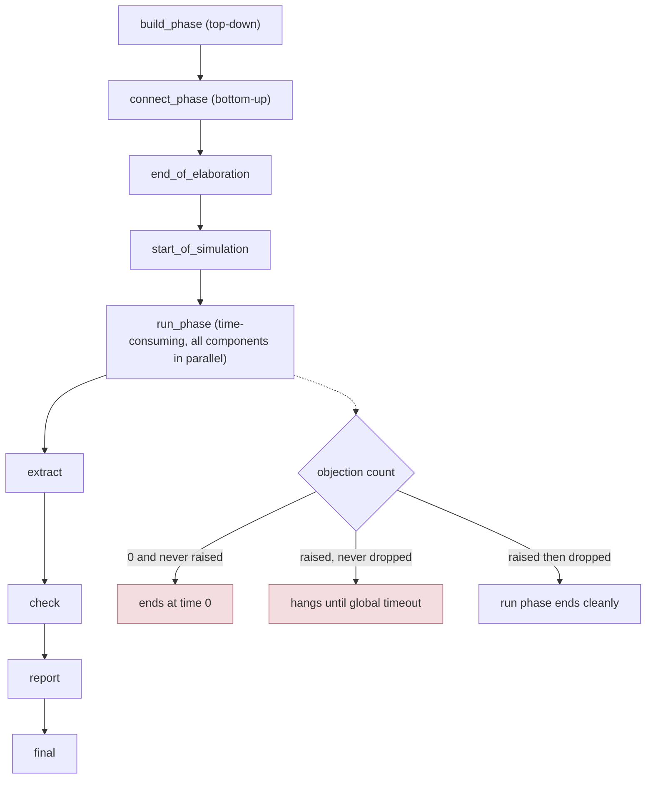

## In my own words
> _Not written yet. Write this yourself, without AI: what it is, why it exists, how it fails. A reviewer checks it before this note becomes `proven`._

## Diagram


## Explain-back check
- What happens if a test never raises an objection? Never drops one?
- Which phases consume simulation time?
- Why does build_phase go top-down but connect_phase bottom-up?

## Predict the bug
What's wrong, and what would you see in simulation?
```systemverilog
task run_phase(uvm_phase phase);
  my_seq seq = my_seq::type_id::create("seq");
  seq.start(env.agt.sqr);
endtask
```

## Evidence
- 2026-10-06 — assessment Q21: half right

## Links
- [[config-db-and-bind]]
