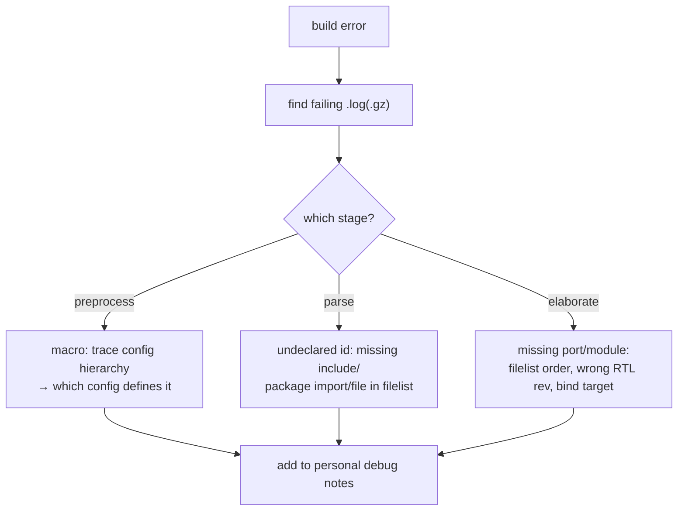

## In my own words
> _Not written yet. Write this yourself, without AI: what it is, why it exists, how it fails. A reviewer checks it before this note becomes `proven`._

## Diagram

## Explain-back check
- Walk through the unidentified-macro debug you're proud of, naming the stage.
- Method for 'missing file': how do you find the filelist that should include it?

## Evidence
- 2026-10-06 — Q22 confirmed (own debug from notes)

## Links
- [[compile-stages]]
