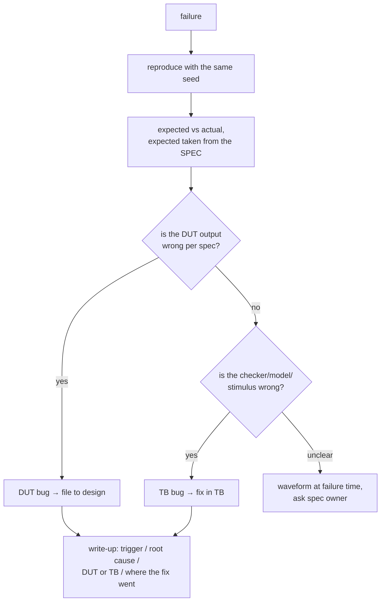

## In my own words
> _Not written yet. Write this yourself, without AI: what it is, why it exists, how it fails. A reviewer checks it before this note becomes `proven`._

## Diagram

## Explain-back check
- Define trigger and root cause, using the multi-instance checker as the example.
- The fix went into the checker binding. Was it a DUT bug or a TB bug?
- Your first 15 minutes on a scoreboard UVM_ERROR, in order.

## Evidence
- 2026-10-28 — verdict misjudged (DUT, but fix in checker)

## Links
- [[config-db-and-bind]]
- [[fifo-scoreboard-rd-valid]]
