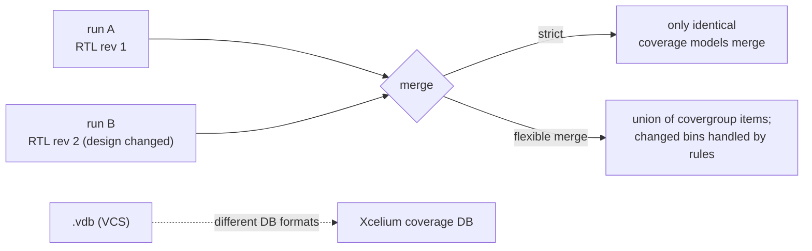

## In my own words
> _Not written yet. Write this yourself, without AI: what it is, why it exists, how it fails. A reviewer checks it before this note becomes `proven`._

## Diagram

## Explain-back check
- What does a flexible merge do when a covergroup changed between two RTL versions?
- What's your plan for VCS and Xcelium coverage during the transition?

## Evidence
- 2026-10-06 — Q12 incorrect, Q29 open

## Links
- [[coverage-group-vs-instance]]
- [[vcs-vs-xcelium]]
