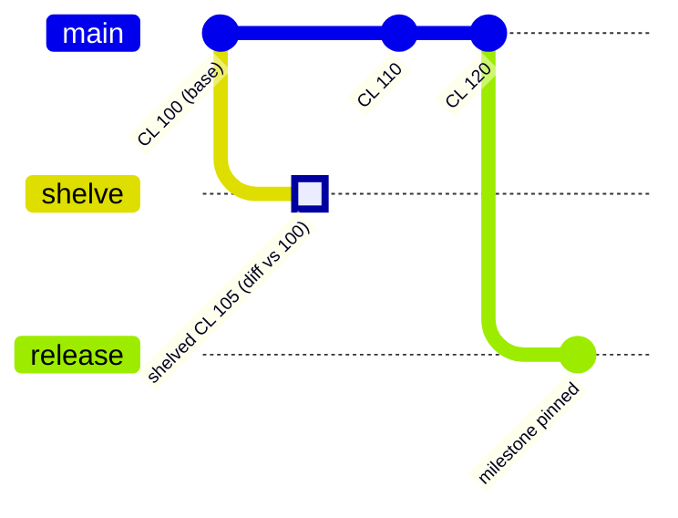

## In my own words
> _Not written yet. Write this yourself, without AI: what it is, why it exists, how it fails. A reviewer checks it before this note becomes `proven`._

## Diagram

## Explain-back check
- Why does a shelve regression need its base changelist?
- Why use a branch for a release milestone instead of mainline at a label?

## Evidence
- 2026-10-06 — Q7, Q9 confirmed

## Links
- [[regression-flow]]
