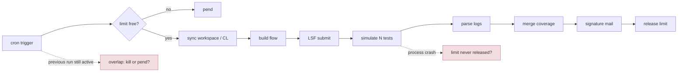

## In my own words
> _Not written yet. Write this yourself, without AI: what it is, why it exists, how it fails. A reviewer checks it before this note becomes `proven`._

## Diagram

## Explain-back check
- Walk the stages from cron trigger to signature mail, with the log location at each stage.
- If the wrapper crashes after LSF submit, what releases the limit? Prove it from the script.
- Why is vcs_run.log deleted, and what's the trade-off?

## Evidence
- 2026-10-06 — Q1–Q6; triage order confirmed; failure paths recurring

## Links
- [[stress-vs-smoke]]
- [[perforce-shelves]]
