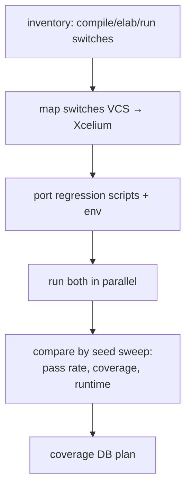

## In my own words
> _Not written yet. Write this yourself, without AI: what it is, why it exists, how it fails. A reviewer checks it before this note becomes `proven`._

## Diagram

## Explain-back check
- Name two concrete flow-breaking differences (switches or formats).
- Write the comparison criteria in one sentence without seed equivalence.

## Evidence
- 2026-10-06 — Q27 partial, Q28 misconception

## Links
- [[seeds-across-simulators]]
- [[coverage-merge]]
